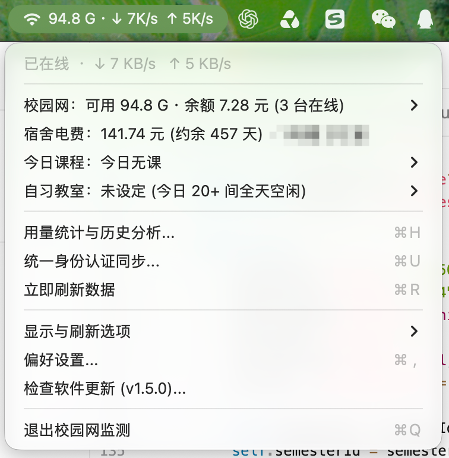
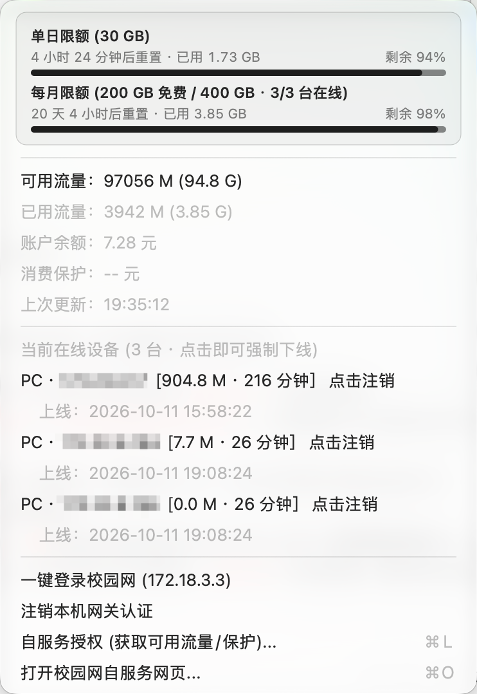
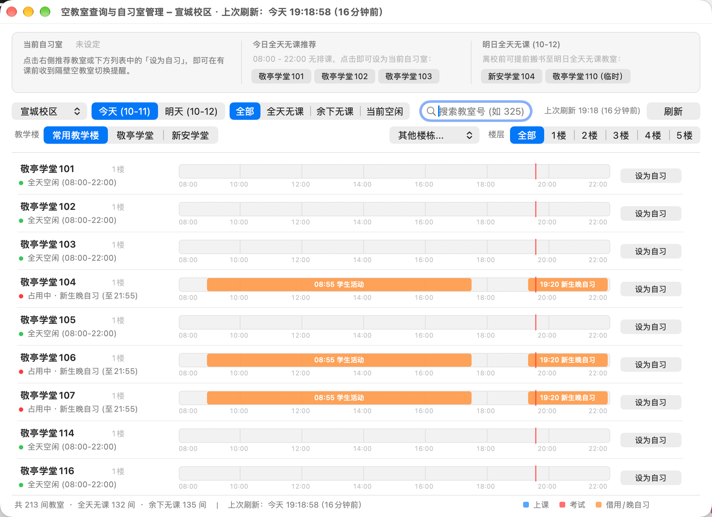
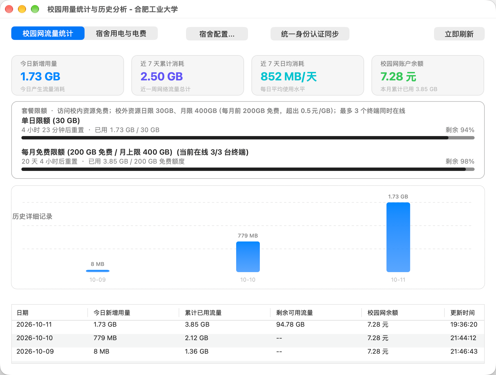
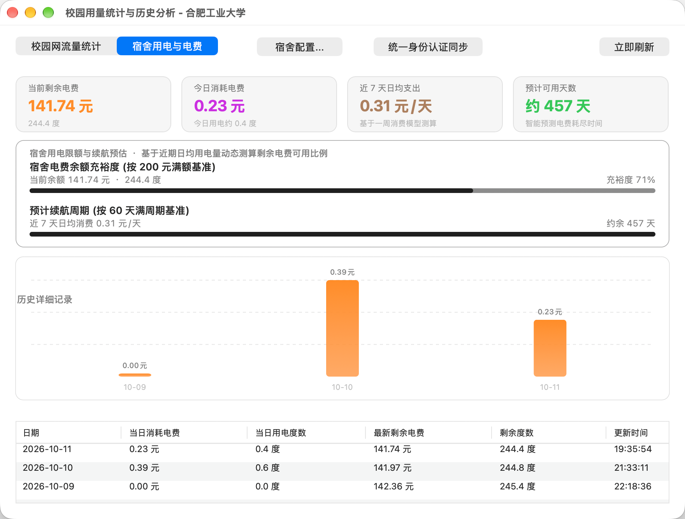

# 📶 HFUTCampusNet

<p align="center">
  
  
  
  
</p>

> 💡 **提示**：校园网与宿舍电费模块目前在**宣城校区**完整验证有效，合肥校区（屯溪路/翡翠湖）可自测；教务周课表与空教室查询支持**宣城、翡翠湖、屯溪路三校区**。

专为合肥工业大学（HFUT）学子打造的原生 macOS 状态栏与桌面效率伴侣。集 **Dr.COM 校园网无感自动重连**、**单日/月度流量限额与在线设备管理**、**宿舍电费监控与续航预测**、**教务系统周课表** 以及 **自习空教室查询与智能换座/搬书推荐** 于一体。

---

## 📸 界面预览

### 1. 状态栏总览与校园网终端管理
顶部状态栏常驻展示实时流量与网速，展开即可查看 **校园网、宿舍电费、今日课程、自习教室** 四大核心状态；二级菜单支持查看 **30 GB 单日限额 / 200 GB 月度免费限额** 进度，并可一键强制下线其他在线设备。

| 状态栏主菜单 | 校园网限额与在线设备管理 |
| :---: | :---: |
|  |  |

### 2. 空教室查询与自习室伴侣
支持 **宣城校区、翡翠湖校区、屯溪路校区** 全教学楼与楼层极速筛选，提供 `08:00 - 22:00` 连续占用时间轴（区分上课、考试、借用/晚自习）：
- **今日全天无课推荐**：打开即推荐当天 `08:00 - 22:00` 全天无排课教室，一坐一整天无需换座；
- **当前自习室冲突提醒**：设定当前自习教室后，若有课或临时活动将提前推送通知，并优先推荐**同楼层隔壁**空闲教室一键切换；
- **晚间离校前 · 明日空教室推荐**：告知当前自习室明天是否继续全空（无需搬书），或推荐明天全天无课的同楼层教室方便提前搬书留座。

<p align="center">
  
</p>

### 3. 校园网流量与宿舍电费历史统计
内置可视化历史统计面板，自动记录每日流量消耗与宿舍用电支出，动态测算 **近 7 天日均消耗** 与 **宿舍电费预计可用天数**：

| 校园网流量统计与限额进度 | 宿舍用电与续航预测 |
| :---: | :---: |
|  |  |

---

## 🌟 核心特性

- 🏫 **自习空教室查询与智能换座伴侣**：
  - 实时同步合工大教务移动端排课接口，覆盖三校区全部教学楼；
  - 直观绘制 `08:00 - 22:00` 教室占用时间轴，支持按「全天无课 / 余下无课 / 当前空闲」、教学楼、楼层与教室号毫秒级过滤；
  - 支持设定「当前自习室」与「明日预约自习室」，上课前自动提醒隔壁空教室切换，跨天自动结转。
- ⚡ **宿舍电费监控与智能续航测算**：
  - 对接慧新易校电控平台，实时展示宿舍剩余电费、剩余度数、今日消耗与近 7 日日均电费；
  - 根据近期用电水平智能估算剩余可用天数，低于设定阈值时自动发送系统通知预警。
- 📶 **校园网无感自动重连与在线终端管理**：
  - 基于 macOS `NWPathMonitor` 与睡眠唤醒监听，Wi-Fi 切换、开盖唤醒或掉线时秒级后台自动完成 `172.18.3.3` 认证；
  - 可视化展示单日 30 GB 与月度 200 GB 免费额度重置倒计时，支持在菜单栏直接踢下线占满名额的终端设备。
- 📚 **合工大教务系统课表同步 (EAMS 5.0)**：
  - 支持同步全学期排课并离线缓存，在状态栏与桌面悬浮组件中实时展示今日课程与上课倒计时；
  - 内置独立 **连续时间轴周课表窗口**（支持 1~24 周切换、当前时间红线指示）。
- 🔑 **统一身份认证 (CAS SSO) 一键全量同步**：
  - 只需登录一次合工大信息门户，即可自动联动同步教务课表、空教室排课、宿舍电费与校园网自服务数据。
- 🍃 **纯原生超低功耗**：
  - 纯 Swift / AppKit 原生构建，无任何第三方依赖，完美适配 macOS 浅色与深色模式，常驻内存低、极度省电。

---

## 🚀 下载与安装

### 方式一：直接下载开箱即用 (推荐)

前往 [Releases 页面](../../releases) 下载最新的 `HFUTCampusNet-macOS.zip`：
1. 解压后将 `HFUTCampusNet.app` 拖入 **「访达 -> 应用程序 (Applications)」**；
2. 双击打开即可使用。

> 💡 **首次打开提示“未知开发者”或“无法验证”？**
> 因为开源软件未购买苹果商业公证证书，首次打开只需操作一次：
> - **方式 1**：在 macOS **「系统设置」→「隐私与安全性」**，滑到下方点击 **「仍要打开」** 即可。
> - **方式 2**：按住键盘 `Control` 键，鼠标右键点击应用选择 **「打开」**。
>
> **设置开机自启动**：在 macOS **「系统设置」→「通用」→「登录项」** 中添加 `HFUTCampusNet` 即可随开机无感启动。

---

### 方式二：从源码本地构建

本项目无任何第三方依赖，本地只要安装有 Xcode Command Line Tools 即可一键编译通用架构（Apple Silicon `arm64` + Intel `x86_64`）应用：

```bash
# 1. 克隆代码仓库
git clone https://github.com/Junpgle/HFUTCampusNet.git
cd HFUTCampusNet

# 2. 一键本地构建
bash build.sh

# 3. 运行应用程序
open HFUTCampusNet.app
```

---

## 🛠️ 便携命令行工具 (CLI)

仓库中同时附带了一个独立轻量的 Python CLI 脚本 `cli/monitor.py`，支持终端直接查询或作为 **SwiftBar / xbar** 插件使用：

```bash
# 查看当前 172.18.3.3 在线认证状态（包含学号、IP、已用流量、余额、在线时长）
python3 cli/monitor.py --status

# 一键认证登录校园网
python3 cli/monitor.py --login

# 一键注销当前设备
python3 cli/monitor.py --logout

# 设置校园网账号与密码
python3 cli/monitor.py --set-portal <学号> <密码>

# 持续测速监控
python3 cli/monitor.py --speed
```

---

## ❓ 常见问题 (FAQ)

1. **为什么提示“未连接校园网络 Wi-Fi”？**
   - 校园网网关认证接口（`http://172.18.3.3/`）与自服务平台（`xywzz.hfut.edu.cn:8443`）属于校内局域网地址，请确保你的 Mac 已连上学校 Wi-Fi、宿舍有线网，或开启了学校官方 WebVPN。
2. **空教室查询为什么点击刷新需要约 10 秒？**
   - 空教室功能需实时向教务系统汇总所选校区多栋教学楼在「今天」和「明天」的全部排课、考试与借用数据。同步完成后会自动缓存到本地，日常切换教学楼、楼层与筛选条件均为毫秒级响应。
3. **账号密码存储安全吗？**
   - 账号密码仅保存在本机本地配置中，所有请求均直接与校内官方服务器通信，绝不会向任何第三方服务器发送任何数据。

---

## 🤝 参与贡献

欢迎提交 Issue 反馈遇到的问题或提出改进想法！如果你改进了功能或优化了界面，欢迎提交 Pull Request。

---

## 📄 开源许可证

本项目基于 [MIT License](LICENSE) 协议开源。
